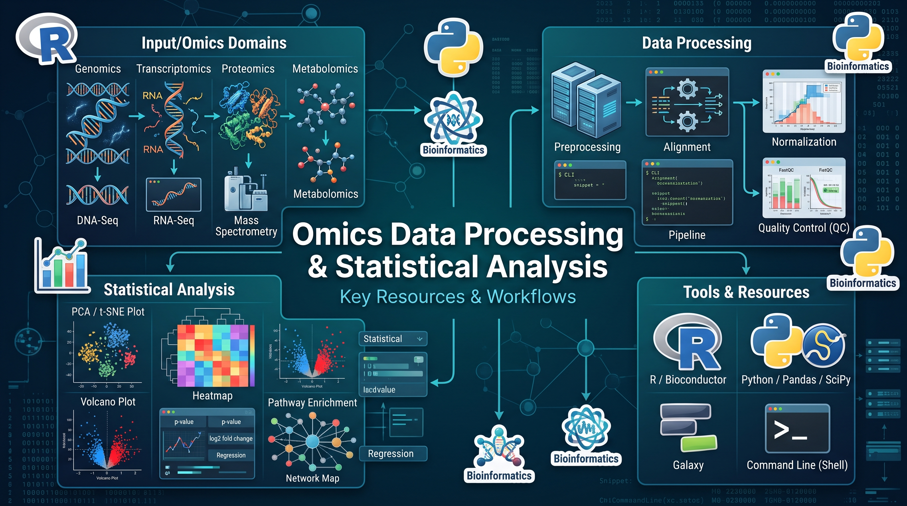

# Bioinformatics & Multi-Omics Resources

A curated collection of bioinformatics and multi-omics resources for biological data analysis, integration, visualization, and downstream interpretation.

## Overview

This repository brings together useful web-based tools, databases, and analytical resources for researchers working in bioinformatics, computational biology, systems biology, and biomedical research.

## Resource Categories

- **Cancer Genomics:** Explore cancer-associated mutations, gene expression, and clinical data.
- **Immunology:** Investigate immune cell populations, immune responses, and immunological datasets.
- **Single-Cell Analysis:** Analyze single-cell RNA sequencing data and cellular heterogeneity.
- **Proteomics:** Explore protein expression, protein interactions, and functional annotations.
- **Metabolomics:** Investigate metabolic profiles and biological pathways.
- **Microbiome Analysis:** Explore microbial communities and microbiome-associated data.
- **Drug Response Analysis:** Investigate drug sensitivity, therapeutic response, and molecular associations.
- **Multi-Omics Integration:** Integrate diverse biological datasets to identify relationships and generate biological insights.

## How to Use This Collection

1. Browse the resource categories.
2. Select a tool based on your research question and data type.
3. Review each resource's documentation and supported input formats.
4. Analyze your data and interpret the results in the context of relevant biological evidence.

## Important Notes

- Check each resource's documentation, access requirements, and data availability.
- Follow the relevant data privacy, licensing, and citation requirements.
- Validate findings using appropriate statistical methods and independent evidence.

## Contributing

Suggestions for additional bioinformatics tools and resources are welcome. Please provide the resource name, website, primary application, and relevant publication or documentation.

---

*Maintained as a practical reference for bioinformatics and multi-omics research.*
